<div align="center">


# learn

**Learn the Linux command line by actually using it.**

A local-first, full-screen terminal learning environment written in Rust.
54 escalating missions, a self-contained POSIX shell, and a verifier that
inspects the *filesystem you actually produced* — not a quiz.

<p align="center">
  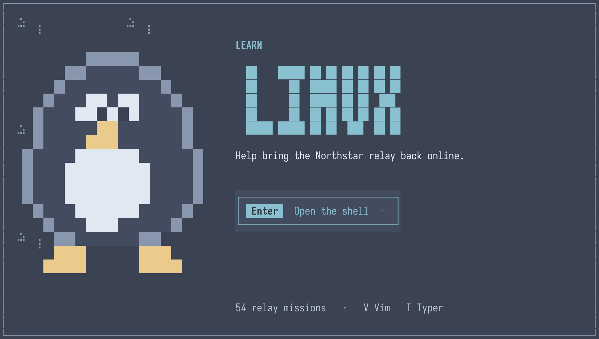
</p>

<br>

[](https://www.rust-lang.org)
[](https://doc.rust-lang.org/edition-guide/rust-2024/index.html)
[](https://doc.rust-lang.org/nomicon/what-unsafe-does.html)
[](https://rust-lang.github.io/rust-clippy/)
[](LICENSE)


[](https://github.com/yourname/learn-linux/actions)
[](https://opensource.org/licenses/MIT)

</div>

---

## Table of Contents

- [Why this exists](#why-this-exists)
- [Quick start](#quick-start)
- [The lesson loop](#the-lesson-loop)
- [Feature tour](#feature-tour)
  - [The command panel](#the-command-panel)
  - [21 built-in themes](#21-built-in-themes)
  - [Docs search that forgives typos](#docs-search-that-forgives-typos)
  - [The Vim dojo](#the-vim-dojo)
  - [The Typer dojo](#the-typer-dojo)
  - [Your terminal has a pet now](#your-terminal-has-a-pet-now)
- [Curriculum](#curriculum)
- [Verifiers](#verifiers)
- [Writing a lesson](#writing-a-lesson)
- [Architecture](#architecture)
- [Runtimes](#runtimes)
- [Safety model](#safety-model)
- [CLI reference](#cli-reference)
- [Keybindings](#keybindings)
- [Where your progress lives](#where-your-progress-lives)
- [Development](#development)
- [Roadmap](#roadmap)
- [License](#license)

---

## Why this exists

Most "learn Linux" material is one of two things: a wall of documentation, or
a puzzle box that checks the string you typed.

**learn** is neither. Every mission gives you a *real shell* in a *real
directory*, and then it looks at the files you made:

```console
$ cat welcome.txt
Northstar relay: night shift begins.
```

That output is the answer. There is no multiple choice, no checkbox, and no
"mark as complete" button — the lesson advances when the verifier inspects the
virtual filesystem and agrees with you.

And it runs **anywhere**. No Bubblewrap, no rootfs, no WSL, no Docker, no Bash
on the host. The lesson shell is a deterministic POSIX simulator compiled into
the binary. Clone it on a laptop on a plane and it works.

<div align="center">
  
  <br>
  <sub>that's <code>relay</code>, the terminal mascot. he walks. he blinks. he never judges you.</sub>
</div>

---

## Quick start

You need **Rust 1.86 or newer**. That's the entire dependency list — there is
no `build.rs`, no `protoc`, no vendored C, and no system packages.

```bash
git clone https://github.com/yourname/learn-linux
cd learn-linux

cargo run --release          # launches the full-screen client
```

That's it. No install step, no runtime to provision.

<p align="center">
  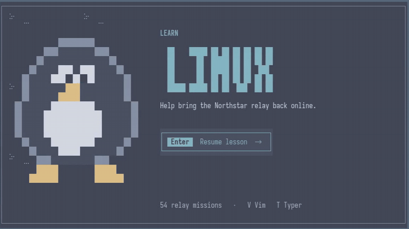
</p>

### Everything else

```bash
cargo run -- content check        # compile all 54 lessons
cargo run -- content simulate --all   # replay every canonical solution
cargo run -- doctor               # what this host supports
cargo run -- doctor --json        # same, machine readable
cargo run -- docs "how do i find text"   # search the offline manual
cargo test --workspace            # 76 tests
```

<details>
<summary><b>Windows (PowerShell / Windows Terminal)</b></summary>

```powershell
cargo test --workspace --locked
cargo build --release --locked
.\target\release\learn.exe
```

The executable is fully self-contained — lessons and the entire offline manual
are embedded. You can copy the single `.exe` anywhere. Lessons behave
identically on Windows because the shell is simulated; only IPC (named pipe
instead of Unix socket) and the progress file location differ.
</details>

---

## The lesson loop

<p align="center">
  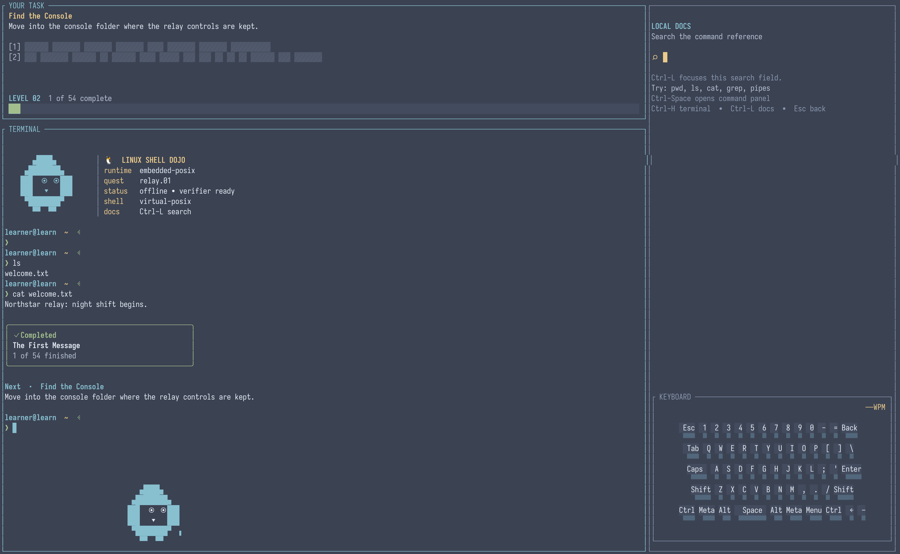
</p>

Every mission is the same shape:

1. **YOUR TASK** — one sentence of intent. Never a wall of text.
2. **Hints** — two, masked behind `▒` until you ask. `Ctrl-1`, `Ctrl-2`,
   `Ctrl-3`, or just click them. Getting a hint costs you nothing but pride.
3. **TERMINAL** — a real shell with a block cursor, `Tab` completion, arrow-key
   history, pipes, redirection, globs and brace expansion.
4. **The verifier** — run after *every* command. The instant the filesystem
   matches the mission, it completes and rolls the next one.

Watch a mission get solved:

<p align="center">
  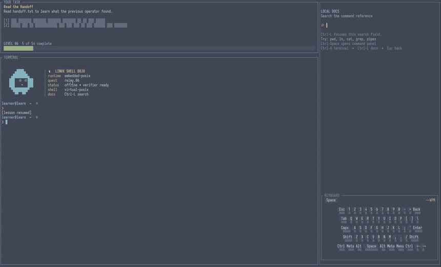
</p>

<p align="center">
  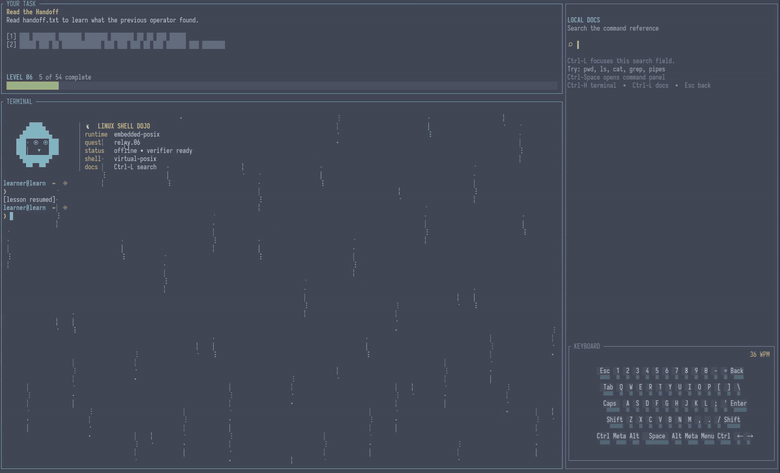
</p>

A few things you will notice:

- **Your first wrong command gives you a hint.** Non-zero exit status escalates
  the hint level automatically — the TUI is watching, not just rendering.
- **Terminal output is themed.** The prompt, the working directory, your
  command and the output each get their own colour, recomputed every frame so
  it follows the active theme.
- **The transcript survives the lesson.** Complete a mission and the frozen
  screen, the `✓ Completed` card and the next objective are appended in place.

---

## Feature tour

### The command panel

`Ctrl-Space` opens a fuzzy command palette from anywhere — lesson, modal,
Vim dojo, or the Typer. It has 31 commands, including all 21 themes.

<p align="center">
  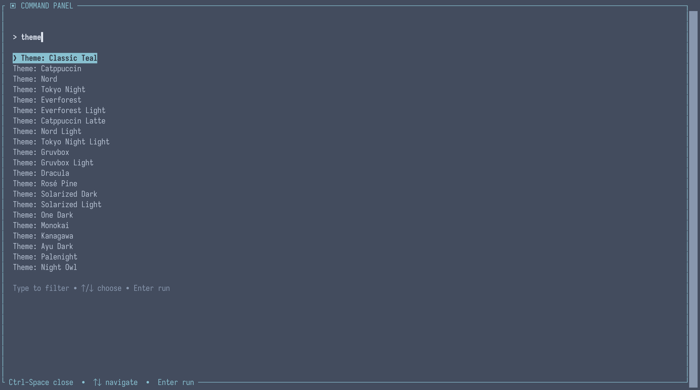
</p>

The matcher is a two-tier design rather than one fuzzy blob:

| Tier | Behaviour | Example |
| --- | --- | --- |
| 1 | Literal prefix match, ranked by field | `thm` → *theme* commands |
| 2 | Adjacent transposition, `+4` penalty | `reastart` → *Reset current challenge progress* |
| 3 | `frizbee` fuzzy fallback, typo budget `len / 4` | `vim snkae` → *Open Vim dojo* |

Only the **best** tier is ever shown. You never get a mixed-quality result list
where the real answer is buried under noise.

---

### 21 built-in themes

`Ctrl-T` cycles instantly through the whole set — dark and light pairs stay
adjacent so the flip is always legible. Every theme is a full 12-colour
struct; nothing is derived or inherited, so there are no half-broken variants.

<p align="center">
  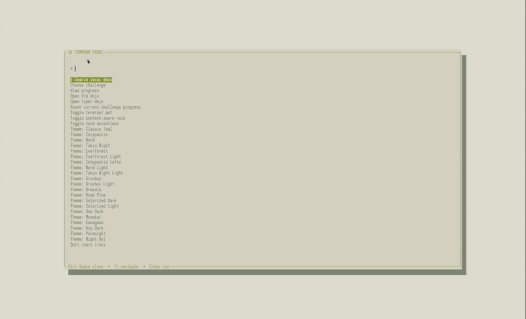
</p>

<table>
<tr><td width="50%">

**Dark (15)**

Classic Teal · Catppuccin · Nord · Tokyo Night · Everforest ·
Gruvbox · Dracula · Rosé Pine · Solarized Dark · One Dark ·
Monokai · Kanagawa · Ayu Dark · Palenight · Night Owl

</td><td width="50%">

**Light (6)**

Catppuccin Latte · Nord Light · Tokyo Night Light ·
Everforest Light · Gruvbox Light · Solarized Light

</td></tr>
</table>

The app boots on **Nord**. Light themes invert their `selected_fg` /
`selected_bg` pair so the selection highlight stays readable — a detail most
themes forget and this one does not.

---

### Docs search that forgives typos

The right-hand pane is a live, offline search over a 29-document manual. It
searches as you type, and it is **genuinely** typo-tolerant.

<p align="center">
  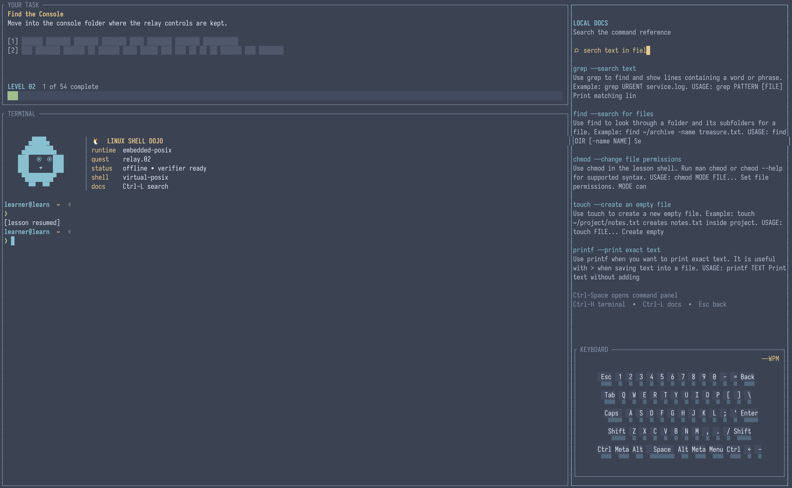
</p>

<p align="center">
  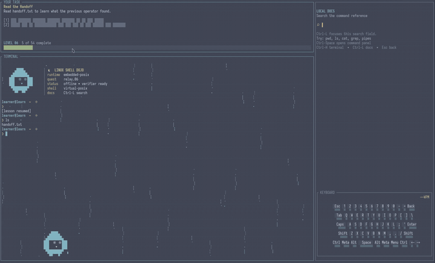
</p>

`Ctrl-L` focuses the field. Try these — they all land on the right page:

| You type | You get |
| --- | --- |
| `serch text in fiel` | `grep` |
| `where am i` | `pwd` |
| `mk a foler` | `mkdir` |
| `read contnts` | `cat` |
| `locate treasur` | `find` |
| `save commnd otput` | `> — save command output to a file` |
| `>` `|` `*` | `shell.redirect` `shell.pipe` `shell.glob` |

Three things make that work:

- **Word order does not matter.** `read page by page` ≈ `by page read`.
  Queries are split into per-word patterns and scored against each document
  independently.
- **Every token must match.** A document is only accepted if *all* tokens hit
  *somewhere*, which kills the "matched one common word, ignored the rest"
  failure mode.
- **Shell metacharacters are first-class.** `>`, `|` and `*` survive
  normalisation, so `search("*")` reliably finds globbing.

The same corpus backs `man`, `help`, `<command> --help`, the sidebar and the
`learn docs` CLI subcommand. One source of truth.

<p align="center">
  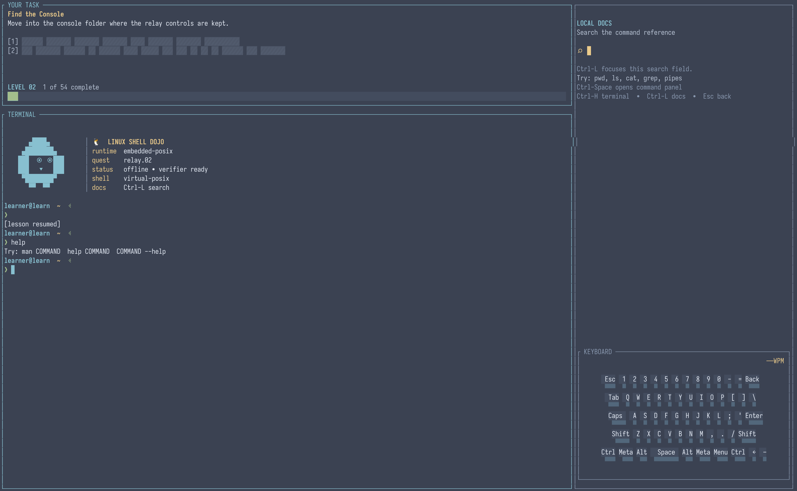
</p>

---

### The Vim dojo

Linux and Vim are not separable skills. Press `V` on the landing screen (or
hit *Open Vim dojo* in the command panel) and you get six drills — each one
isolates a single muscle memory until it is boring.

<p align="center">
  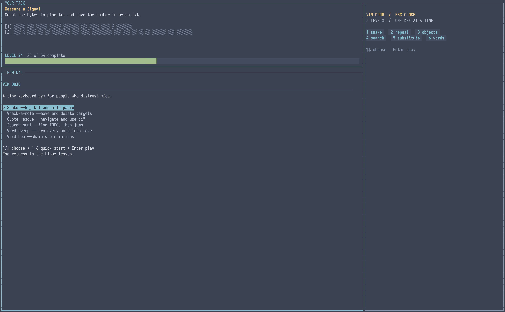
</p>

| # | Drill | What it drills |
| --- | --- | --- |
| 1 | **Snake** | `h` `j` `k` `l` — and only those keys |
| 2 | **Repeat & repair** | move, then `x` to delete a target |
| 3 | **Quote rescue** | the text object `ci"` on `const path = "tmp/cache";` |
| 4 | **Search hunt** | `/TODO`, then `n` to jump |
| 5 | **Word sweep** | `:%s/hate/love/g` |
| 6 | **Word hop** | `w`, `b`, `e` chained |

<p align="center">
  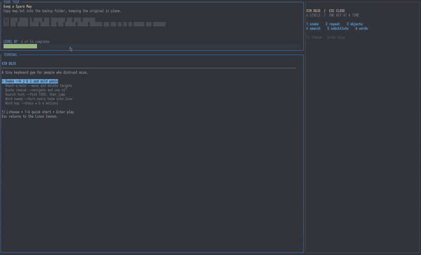
</p>

<p align="center">
  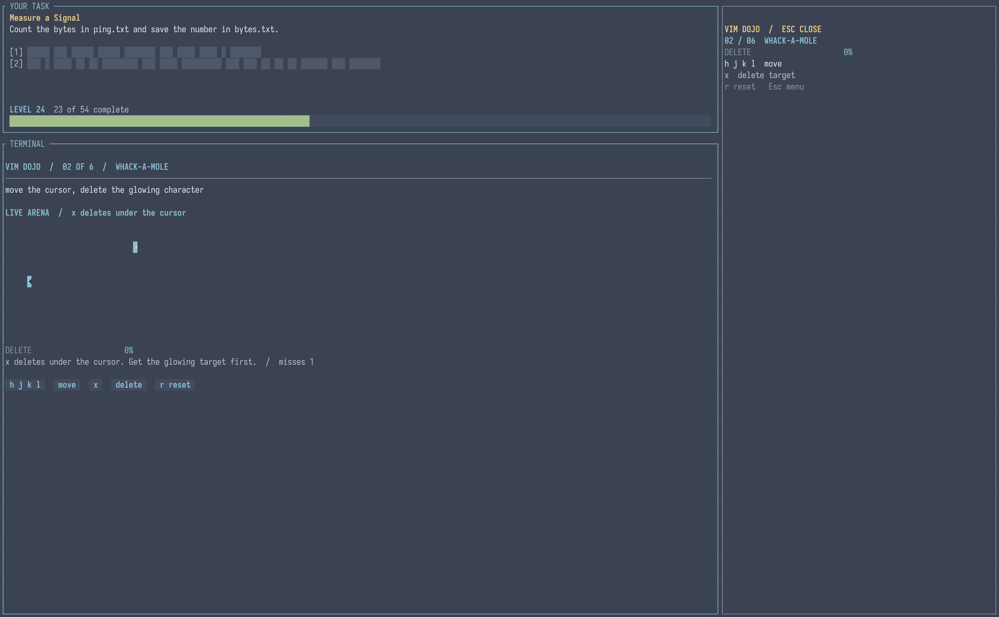
</p>

`Esc` returns you to the lesson, always. The dojo is a practice surface, never
a trap.

---

### The Typer dojo

Press `T` on the landing screen. A 30-second drill over Linux commands and
Linux facts — `find . -name '*.log' -type f`, `grep -R 'TODO' src | head -n 10`,
*"A dotfile is a file whose name starts with a dot."*

<p align="center">
  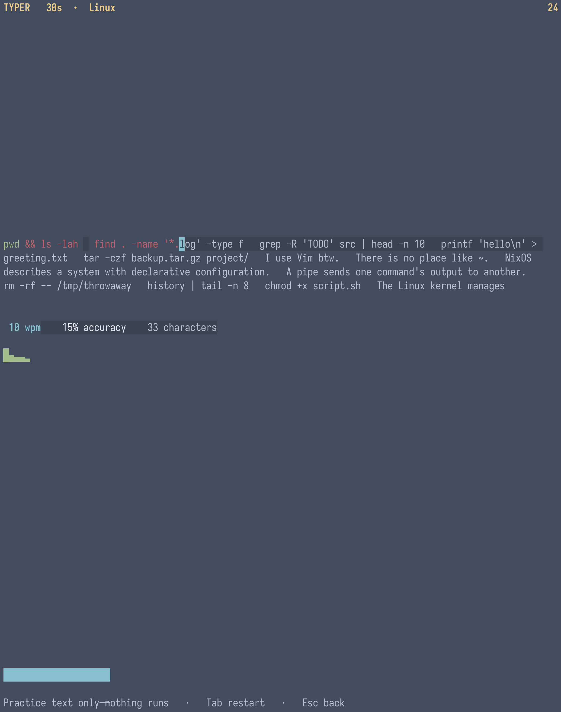
</p>

<p align="center">
  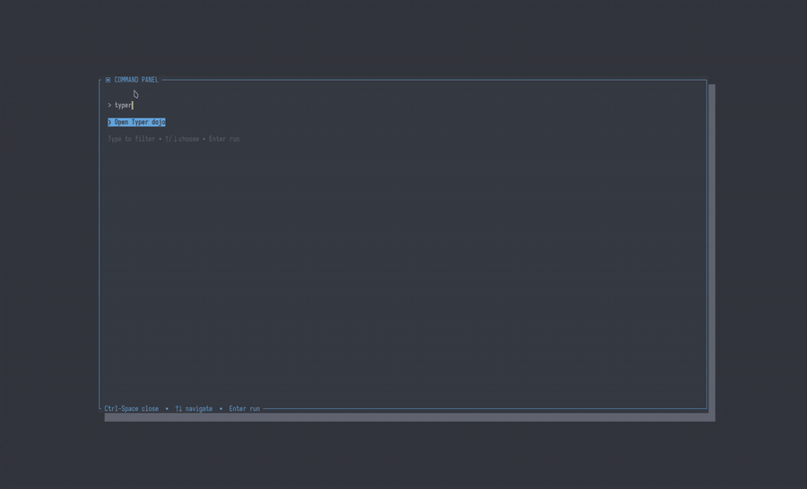
</p>

Three details that matter:

- **It executes nothing.** The buffer is a plain `Vec<char>`. A unit test
  pins that a `rm -rf` phrase is present in the corpus and provably inert.
- **It pauses when you open the command panel.** The clock does not run while
  you are reading the palette.
- **It shows a live WPM graph.** One sample per second, not a single number
  at the end.

---

### Your terminal has a pet now

Two easter eggs live inside the terminal pane, both off by default, both
toggleable from the command panel.

**`relay`** — the mascot. He wakes after 2.3s, walks at one cell per 280ms,
pauses every fourth step (a cat does not glide), blinks every 4.3s, animates
his feet on a three-frame cycle, and turns around when he hits a wall. Press
`←` or `→` and he follows your facing direction. He only ever draws into
blank cells, so he is never an obstruction over lesson output.

<p align="center">
  
</p>

**Content-aware rain** — Matrix rain, but the glyphs and fall rate are seeded
from the **challenge ID**. A `search` mission rains `⠂ ╎ ⋮ ┊ │`; a `files`
mission rains `╎ ┆ ┊ ╿ │`. Every lesson gets its own deterministic pattern.

A fifth easter egg lives on the landing screen: a braille-rendered
[Conway's Game of Life](https://en.wikipedia.org/wiki/Conway%27s_Game_of_Life),
seeded with gliders, ticking every 320ms.

There is also a **live keyboard visualiser** pinned to the bottom of the
sidebar. It distinguishes left from right `Ctrl`, tracks your last four keys,
and computes a rolling WPM figure from your actual keystrokes — using the
`REPORT_ALL_KEYS_AS_ESCAPE_CODES` terminal extension, which is why it can tell
`Ctrl+C` from `Ctrl+Shift+C`.

---

## Curriculum

54 missions, `relay.01` through `relay.54`, arranged as six chapters of nine.
Each builds on the last; the skill graph is validated for cycles and dangling
prerequisites at load time.

| # | Chapter | Level | Missions | Core skills |
| --- | --- | --- | --- | --- |
| **A** | First Shift | beginner | `relay.01`–`09` | `cat` `cd` `mkdir` `touch` `printf` `>` `cp` `mv` `rm` |
| **B** | Finding Signal | beginner | `relay.10`–`18` | `mkdir -p`, `~` paths, brace expansion `{1..3}`, globs `*.log`, `find -name` |
| **C** | Sorting Noise | intermediate | `relay.19`–`27` | `grep` `head` `tail` `>>` pipes `\|` `wc` `sort` `uniq` |
| **D** | Permissions | intermediate | `relay.28`–`36` | octal `600`/`640`/`644`, symbolic `u+x` `go-r`, `u=rw,go=`, `stat` |
| **E** | Deep Recovery | advanced | `relay.37`–`45` | `find` + `grep` combined, three-stage pipelines, glob-copy → prune → `chmod` |
| **F** | Restore Northstar | advanced | `relay.46`–`54` | multi-tool repairs, safe config restore, the `relay.54` capstone |

**By the numbers:** 54 missions · 18 beginner / 18 intermediate / 18 advanced ·
108 hints · 117 setup actions · 90 verifier predicates · ~297 minutes of
estimated seat time · 26 shell commands.

### The simulated shell

`cat` `cd` `chmod` `clear` `cp` `echo` `exit` `find` `grep` `head` `help`
`less` `ls` `man` `mkdir` `mv` `printf` `pwd` `rm` `sort` `stat` `tail`
`touch` `true` `uniq` `wc`

Plus the language itself: pipes, `<` `>` `>>` redirection, single and double
quoting, backslash escapes, `*` and `?` globs, brace lists (`{a,b}`) and
brace ranges (`{0..10..2}`, zero-padded).

Some of it is deliberately literal. `grep` matches substrings, not regular
expressions — because a byte-deterministic verifier is worth more to you than
regex fidelity in a teaching shell.

---

## Verifiers

A mission is a boolean expression over the state you produced. It is data, not
code, so it can be compiled, diffed, linted and executed in CI.

```kdl
verify {
    all {
        file-exists     "~/console"
        file-read       "~/console/readme.txt" "Northstar relay"
        file-mode       "~/console/readme.txt" "600"
        file-equals     "~/console/report.txt" "shift 47 clean"
        file-missing    "~/console/scratch.tmp"
        cwd             "~/console"
    }
}
```

**Combinators** — `all { … }`, `any { … }`, `not { … }`

**Predicates**

| Node | Passes when |
| --- | --- |
| `file-exists "PATH"` | the path exists |
| `file-missing "PATH"` | the path does **not** exist |
| `file-equals "PATH" "TEXT"` | byte-exact content |
| `file-text-equals "PATH" "TEXT"` | equal, tolerating one trailing newline |
| `file-contains "PATH" "TEXT"` | substring |
| `file-read "PATH" "TEXT"` | contains the text **and you actually read it** |
| `file-mode "PATH" "OCTAL"` | permission bits, octal |
| `cwd "PATH"` | current working directory |

Two of these deserve attention:

- **`file-read` proves you read it.** The simulator tracks which paths you
  actually opened with `cat` or `less`. You cannot pass a "read the briefing"
  mission by guessing the contents. The native backend mirrors this by parsing
  the typed command stream.
- **`file-text-equals` forgives one trailing newline.** So `echo ready` and
  `printf ready` are both correct answers — the lesson grades the intent, not
  your newline habits.

Verifiers run **after every keystroke that submits a command**, not just at the
end. The mission lights up the moment you are right.

---

## Writing a lesson

Content is [KDL](https://kdl.dev), compiled at build time and embedded into the
binary. One real mission, trimmed:

```kdl
challenge "relay.37" version=1 {
    title "A Signal Deep in Storage"
    summary "Deep Recovery — repair the Northstar relay."
    difficulty "advanced"
    estimated-minutes 7

    skills {
        requires "relay.step.36"
        teaches  "relay.step.37"
    }

    state  "ephemeral"
    shell  "bash"
    capabilities {
        network "none"
        tools {
            allow "cat"
            allow "find"
        }
    }

    objective {
        text "Find pulse.txt under storage and read the live pulse message."
    }

    setup {
        mkdir "~/storage/old/2019"
        mkdir "~/storage/ridge/2026"
        write "~/storage/old/2019/pulse.txt"   { text "obsolete\n" }
        write "~/storage/ridge/2026/pulse.txt" { text "pulse stable at ridge\n" }
    }

    verify {
        all {
            file-read "~/storage/ridge/2026/pulse.txt" "pulse stable at ridge"
        }
    }

    hints {
        hint level=1 { text "Search the ridge branch, not the old archive." }
        hint level=2 { text "Once find returns a path, pass that path to cat." }
    }

    solution {
        concept "Narrowing a search tree avoids irrelevant matches."
        command "find ~/storage/ridge -name pulse.txt"
        command "cat ~/storage/ridge/2026/pulse.txt"
    }
}
```

The compiler enforces a lot, and the interesting rule is this one:

> **A canonical solution may only use tools the mission declares.**
> `validate_solution_tools` tokenises every `solution { command }`, tracks
> command position across `|`, `||`, `&&`, `;` and redirection, and rejects
> the pack if a solution reaches for an undeclared binary. A lesson can
> therefore never *require* something it did not hand you.

Other enforced invariants: every path must resolve under `/home/learner`;
`file-mode` octal must be ≤ `0o777`; hint levels must be unique; a solution
needs at least one command; IDs must be unique across the pack; the skill
graph must be acyclic with no dangling prerequisites.

And then the real gate — **the canonical solution must actually pass**:

```bash
cargo run -- content simulate --all
```

This types every solution into a live simulated shell, with the real `setup`
applied, and evaluates the mission's own verifier. If it does not pass, the
command fails. You cannot ship a broken lesson.

---

## Architecture

Eight crates in a Cargo workspace. Pure domain at the bottom, pixels at the top,
`unsafe` nowhere — `#![forbid(unsafe_code)]` is enforced workspace-wide.

```mermaid
graph TD
    APP["app/learn<br/><i>clap CLI · 305 lines</i>"]
    TUI["learn-tui<br/><i>Ratatui · Crossterm · vt100</i><br/>3900 + 1640 + 407 + 343 lines"]
    DAEMON["learn-daemon<br/><i>orchestration · redb · IPC</i><br/>1543 lines"]
    PROTO["learn-protocol<br/><i>prost messages · 4-byte BE framing</i><br/>427 lines"]
    RT["learn-runtime<br/><i>POSIX simulator · bwrap backend · doctor</i><br/>1303 + 2320 lines"]
    CH["learn-challenge<br/><i>KDL compiler + validators</i><br/>852 lines"]
    DOCS["learn-docs<br/><i>offline manual · fuzzy search</i><br/>709 lines"]
    CORE["learn-core<br/><i>types · sandbox paths · verifier algebra</i><br/>619 lines"]

    APP --> TUI
    APP --> DAEMON
    TUI --> DAEMON
    TUI --> RT
    DAEMON --> RT
    DAEMON --> PROTO
    DAEMON --> CH
    DAEMON --> DOCS
    RT --> CORE
    CH --> CORE
    PROTO -.->|"Envelope ⇄ Envelope"| DAEMON
```

| Crate | Lines | Responsibility |
| --- | ---: | --- |
| `learn-core` | 619 | Identifiers, `SandboxPath`, the verifier algebra, the skill DAG. No I/O. |
| `learn-protocol` | 427 | `prost` message types, length-delimited framing, 8 MiB frame cap. |
| `learn-runtime` | 3623 | The simulated POSIX shell, the optional Bubblewrap backend, `doctor`. |
| `learn-challenge` | 852 | KDL → `ChallengeSpec`, plus every content invariant. |
| `learn-docs` | 709 | The 29-document offline manual and its typo-tolerant ranking. |
| `learn-daemon` | 1543 | Content loading, session lifecycle, redb persistence, IPC server + client. |
| `learn-tui` | 6299 | The full-screen client: layout, themes, palette, mascot, Vim dojo, Typer. |
| `app/learn` | 305 | The `learn` binary and its clap surface. |

### Design notes

**`learn-core` is pure.** No I/O, no allocation games, no clock. Path
confinement, boolean verifier composition and graph cycle detection are all
total functions you can unit-test in microseconds — and they are.

**The protocol has no `.proto` files.** Messages are declared with
`#[derive(prost::Message)]` in Rust, so there is no `protoc` in the build and
no codegen to keep in sync. Framing is a 4-byte big-endian length prefix; the
size cap is enforced on encode, on decode *before* slicing, and again in the
daemon's async reader before it allocates. Round-trip tests assert that raw
non-UTF-8 PTY bytes (`0x00 0xFF 0x0A`) survive intact.

**The TUI runs in-process by default.** The IPC path exists and is tested — a
real `AF_UNIX` socket on Unix, a real named pipe on Windows, both with a full
typed handshake — but `cargo run` hands the client a direct `&Daemon`. No socket
in the hot path.

**Screens are re-emitted every frame.** The full buffer is repainted with the
theme surface each tick, so a `Ctrl-T` theme change recolours even the cells
the terminal emulator did not write this frame. It is slightly wasteful and it
is completely correct.

---

## Runtimes

`learn doctor` tells you exactly what this host can do:

```console
$ learn doctor
Learn runtime doctor

[OK] WASM lesson runtime: embedded guest ABI v1; deterministic virtual Linux
[OK] Linux kernel: 7.2.9
[OK] Bubblewrap: bubblewrap 0.12.0
[OK] native-user-namespace: unprivileged user namespace probe
[OK] native-mount-namespace: Bubblewrap namespace construction probe
[OK] native-pid-namespace: isolated process namespace probe
[OK] native-network-namespace: isolated network namespace probe
[OK] native-new-session: required session isolation flag
[OK] native-pty: portable-pty is available
[INFO] native-rootfs: runtime rootfs does not exist
```

### Default: the embedded POSIX runtime

Every lesson gets a fresh in-memory virtual filesystem rooted at
`/home/learner`. `VirtualShell` is a `BTreeMap<String, Node>` where `Node` is
a directory or a file with bytes and a mode — and there is deliberately **no
symlink node type**, which makes symlink escape structurally impossible rather
than merely guarded against.

The lesson shell is a full line-discipline implementation: `Enter` executes,
`^C` clears the line, `^D` closes the session, `^A`/`^E` are Home/End, arrows
move and recall history, `Tab` completes commands and then paths (with a
three-column list when there are many matches), `Backspace` is UTF-8 aware.

It talks to your host through exactly one escape sequence — an OSC 777
`LEARN_PWD` marker on the prompt, which is how the TUI and the native backend
track the working directory without parsing prompt strings.

> A note on honesty: the embedded bundle is a 46-byte WASM module that exports
> `abi_version() -> 1`. The POSIX semantics are native Rust. It is a
> deterministic **Linux-semantic simulation**, not a Linux kernel — and the
> project says so rather than implying otherwise.

### Optional: the native Bubblewrap backend

For content that genuinely needs a kernel, a second backend runs real Bash
inside Bubblewrap. It is opt-in, and it is strict about what it will accept:

```bash
--clearenv --die-with-parent --new-session
--unshare-user --unshare-pid --unshare-ipc --unshare-uts --unshare-net
--ro-bind  <rootfs> /          --proc /proc     --dev /dev
--bind    <session-home> /home/learner
--dir     /tmp                --chdir /home/learner
--setenv  HOME=/home/learner  PATH=/usr/bin:/bin  PS1=…LEARN_PWD…
-- /bin/bash --noprofile --norc -i
```

Three things worth calling out:

- **Bubblewrap ≥ 0.12.0 is a hard requirement.** Older versions are rejected
  and reported as `[INFO]`, never as a false `[OK]`. There is a test that
  asserts the doctor cannot claim an old bwrap is safe.
- **Tools are hidden, not just discouraged.** Under
  `ExternalExecutableVisibility` the runtime `--tmpfs`-masks `/bin`,
  `/usr/bin`, `/sbin`, `/usr/sbin` and both `/usr/local` prefixes, then
  `--ro-bind`s back only the declared tools and `bash`. A mission that says
  `allow "grep"` means `grep` is the only external binary that exists.
- **Capabilities fail closed.** `NetworkPolicy::HostNetwork` and
  `StateMode::PersistentHome` return explicit errors rather than being
  silently downgraded.

---

## Safety model

The threat model is simple: a learner will type `rm -rf /` eventually, and the
host must be indifferent to it.

**Path confinement is one chokepoint.** Every path in every code path — the
KDL compiler, the simulator, the native backend — funnels through
`SandboxPath::parse`. It expands `~`, resolves `.` and `..` textually, refuses
to pop past the root, and then rejects anything that is not `/home/learner` or
underneath it. `/etc/passwd` fails to compile. `touch ../../escape.txt` fails
to run. Both are unit-tested.

**The default runtime cannot touch your host.** `wasm.rs` does not read or
write the filesystem at all. The VFS is a map. There is no syscall surface to
audit because there is no syscall surface.

**The native backend is defence in depth.** Read-only root bind, a writable
bind limited to a freshly-created session-unique temp home, five unshared
namespaces, `--clearenv`, `--new-session`, `--die-with-parent`, tmpfs `/proc`
and `/dev`, a fresh `/tmp`, a minimal `PATH`, and a home directory deleted on
`Drop`.

**Frames are bounded.** 8 MiB, checked in three separate places. Snapshots are
bounded at 1 MiB and validated for version, challenge-id match, and a cwd that
is a directory under `/home/learner`. History is capped at 500 entries.

**And `#![forbid(unsafe_code)]` is on in the workspace, in every crate, and in
the binary.** There is not one `unsafe` block in the project.

---

## CLI reference

The TUI is the product, but nothing is locked inside it.

```console
$ learn --help
Learn Linux through real, verifiable shell challenges

Commands:
  tui      Launch the full-screen client
  daemon   Run the daemon over local IPC (Unix socket or Windows named pipe)
  shell    Attach a plain terminal to one real sandboxed challenge
  doctor   Inspect host/runtime capabilities
  runtime  Install or verify a prepared Linux rootfs
  content  Validate all built-in KDL content
  graph    List the compiled skill/challenge path
  docs     Search the offline command reference
  status   Show the local progress file
  reset    Reset one challenge's local progress
  version  Print the version
```

| Command | What it does |
| --- | --- |
| `learn` | Launch the client. No subcommand needed. |
| `learn shell <id>` | Attach a plain terminal to one mission — no TUI, pipes and all. |
| `learn content check` | Compile all content and report schema errors. |
| `learn content simulate --all` | Replay every canonical solution and assert it verifies. |
| `learn docs <query> [-n 5]` | Search the offline manual from your shell. |
| `learn graph` | Print the compiled skill path. |
| `learn status` | Show completion and attempts. |
| `learn reset <id>` | Reset one mission. |
| `learn doctor [--json]` | Capability report, human or machine readable. |
| `learn runtime install <src>` | Install a prepared rootfs for the native backend. |
| `learn daemon` | Serve over local IPC. |

```console
$ learn docs "how do i stop a running command"
command.kill — …
```

---

## Keybindings

Every action is discoverable through the command panel. There are no function
keys.

| Key | Action |
| --- | --- |
| `Ctrl-Space` | Command panel — from anywhere |
| `Ctrl-T` | Cycle all 21 themes |
| `Ctrl-H` | Focus the terminal |
| `Ctrl-L` | Focus the docs pane |
| `Ctrl-1` `Ctrl-2` `Ctrl-3` | Reveal hint 1, 2 or 3 |
| `←` `→` | Move the cursor — and point the mascot |
| `Enter` | Execute |
| `Tab` | Complete commands, then paths |
| `↑` `↓` | Recall history |
| `Esc` | Back / clear query / quit from the landing screen |
| `V` `T` | Vim dojo / Typer, from the landing screen |

**Mouse** works too: click a hint to reveal it, drag to select lesson text and
release to copy it via OSC 52 (with a `wl-copy` fallback under Wayland).

---

## Where your progress lives

One file. That's it.

| | |
| --- | --- |
| **Format** | [redb](https://docs.rs/redb) — embedded ACID key/value |
| **Unix** | `$XDG_STATE_HOME/learn/progress.redb`, else `$HOME/.local/state/learn/progress.redb` |
| **Windows** | `%LOCALAPPDATA%\LearnLinux\progress.redb` |
| **Socket** | `$XDG_RUNTIME_DIR/learn/daemon.sock`, else a temp-dir fallback |

It stores per-mission status, attempt counts, which mission you were on, your
last 500 shell commands, and a snapshot of the unfinished workspace — so
closing the app mid-mission and reopening it puts you back exactly where you
were, files and all. `[lesson resumed]` is printed when it works.

If the state directory is read-only, the store transparently falls back to a
temp directory rather than losing your progress.

---

## Development

```bash
cargo test --workspace                                   # 76 tests
cargo fmt --all -- --check
cargo clippy --workspace --all-targets --all-features -- -D warnings
```

The workspace runs `clippy::pedantic` at `warn` across all crates, plus
`missing_docs` and `missing_debug_implementations`. It is clean.

### Where the tests live

All 76 are inline unit tests — there are no integration-test files, because
almost everything worth testing here is a pure function or a reducer.

| Crate | Tests | Notable |
| --- | ---: | --- |
| `learn-runtime` | 33 | Brace ranges, glob-before-`cp`, path confinement, tab completion, snapshot restore, OSC-777 scanning across fragmented reads |
| `learn-tui` | 26 | Theme cycling wraps, block cursor geometry, palette search never steals shell keys, Game-of-Life braille subcells, the motion toggle |
| `learn-daemon` | 5 | redb survives reopen, resume survives a daemon restart, legacy JSON defaults, **a real Unix socket and a real named pipe** |
| `learn-core` | 5 | Path escape rejection, verifier composition, DAG cycle rejection |
| `learn-challenge` | 4 | The embedded content matches the repo content byte-for-byte; 54 challenges, split 18/18/18 |
| `learn-docs` | 2 | `"serch text in fiel"` → `grep`, `"where am i"` → `pwd` |
| `learn-protocol` | 1 | Frame round-trip preserves `0x00 0xFF 0x0A` |

Two of these are load-bearing: the daemon's socket tests run a real
`Daemon::serve` and complete a full typed handshake, and the challenge test
asserts the `include_str!`-embedded pack is **identical** to the file on disk —
so content can never silently drift between the repo and the binary.

### Project layout

```
learn-linux/
├── app/learn/               # the `learn` binary
├── crates/
│   ├── learn-core/          # types, sandbox paths, verifier algebra
│   ├── learn-protocol/      # prost messages + framing
│   ├── learn-runtime/       # POSIX simulator + bwrap backend + doctor
│   ├── learn-challenge/     # KDL compiler
│   ├── learn-docs/          # offline manual + fuzzy search
│   ├── learn-daemon/        # orchestration, redb, IPC
│   └── learn-tui/           # the full-screen client
├── content/challenges/
│   └── northstar.kdl        # all 54 missions, 2571 lines
└── docs/                    # images, gifs, and the animated mascots
```

---

## Roadmap

Roughly in order:

- [x] Embedded POSIX runtime — no host dependencies
- [x] 54 missions, 6 chapters, verifier-driven completion
- [x] Offline manual with typo-tolerant search
- [x] Command panel, 21 themes, Vim dojo, Typer
- [x] Optional native Bubblewrap backend
- [ ] More missions — process control, networking, systemd, scripting
- [ ] Broader doc corpus — `chown`, `ps`/`kill`, package managers, editors
- [ ] Persisted preferences — theme, pet, rain, motion
- [ ] Scrollback navigation (`PgUp`/`PgDn`) and bracketed paste
- [ ] Community content packs with a trust level
- [ ] A `proptest` suite for the shell parser and the verifier evaluator

There is deliberately **no XP, no coin economy and no daily streak**. The plan
says *"do not reduce progress to XP"*, and 54 real missions is already enough
motivation. The mascot has your back.

---

## License

MIT.

Built with [Ratatui](https://ratatui.rs), [Crossterm](https://github.com/crossterm-rs/crossterm),
[vt100](https://crates.io/crates/vt100), [tachyonfx](https://crates.io/crates/tachyonfx),
[frizbee](https://crates.io/crates/frizbee), [redb](https://crates.io/crates/redb),
[prost](https://crates.io/crates/prost) and [portable-pty](https://crates.io/crates/portable-pty).

<div align="center">


<sub>go break something. <code>learn reset</code> exists.</sub>

</div>